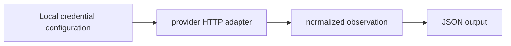

# AI Provider Access Inspector

**Provider access diagnostics, model catalogues and structured account observations.**

  [](LICENSE)

[Overview](#overview) · [Quickstart](#quickstart) · [Example](#example) · [Validation](#validation) · [Documentation](#documentation)

## Overview

Python CLI for inspecting configured AI provider access, model catalogs and account metadata.

**Stack:** Python standard library · HTTP GET · JSON · unittest

## Interpret access states

| Component | Behavior |
| --- | --- |
| Provider adapters | Ten adapters query supported account/model endpoints without inference prompts. |
| Distinct outcomes | Missing, invalid, restricted, partial, rate-limited and unavailable results retain different meanings. |
| Structured output | CLI observations can be exported as JSON for inspection. |

## Processing path



## Quickstart

```console
python -m venv .venv
# Activate .venv, then:
python key_audit.py --help
python -m unittest discover -s tests -v
```

The commands above install prerequisites or run the specified offline checks. Live collection, cloud operations, messaging and trading are separate operational steps when present.

## Example

**Inspect the workflow**

Use `--provider` to select adapters, `--models-limit` to bound model output and `--timeout`/`--workers` to control requests. `--json` prints structured output; `--output` writes it locally. CLI help and offline tests need no provider secret. Account queries require your own credentials.

## Configuration and storage

Python 3.10+ and the standard library are sufficient. [.env.example](.env.example) lists the adapter-specific credential names. Exported account metadata can be sensitive even when secret values are not printed.

## Repository guide

| Location | Responsibility |
| --- | --- |
| [key_audit.py](key_audit.py) | CLI entrypoint |
| [keyscope/providers.py](keyscope/providers.py) | Provider adapters |
| [keyscope/http.py](keyscope/http.py) | HTTP boundary |
| [tests](tests) | Offline fixtures and checks |

## Validation

These checks use offline fixtures or controlled backends.

## Scope and operational boundaries

A listed model does not prove inference access, available credit or permission to use every capability. Account endpoints and response coverage differ across providers.

## Documentation

- The repository guide above links directly to the implementation and configuration files.

## License and attribution

Project-authored source code is licensed under the [MIT License](LICENSE). Third-party components and datasets retain their respective rights and licenses.
